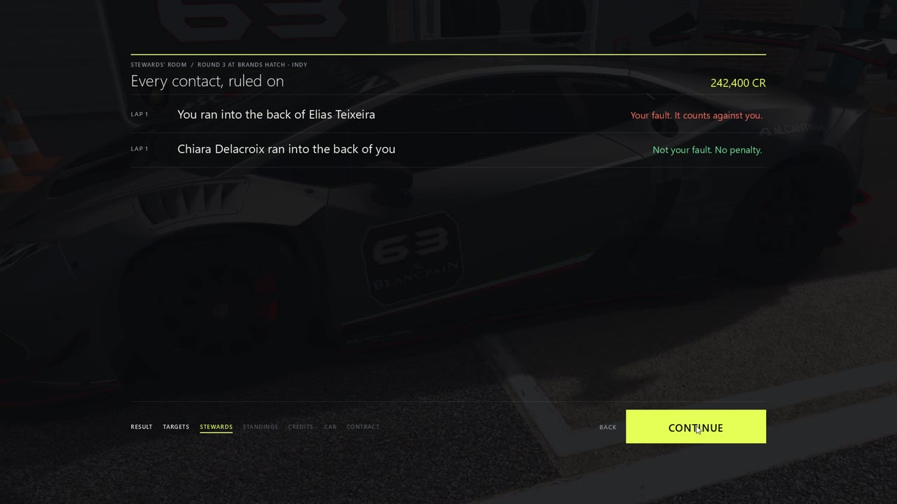
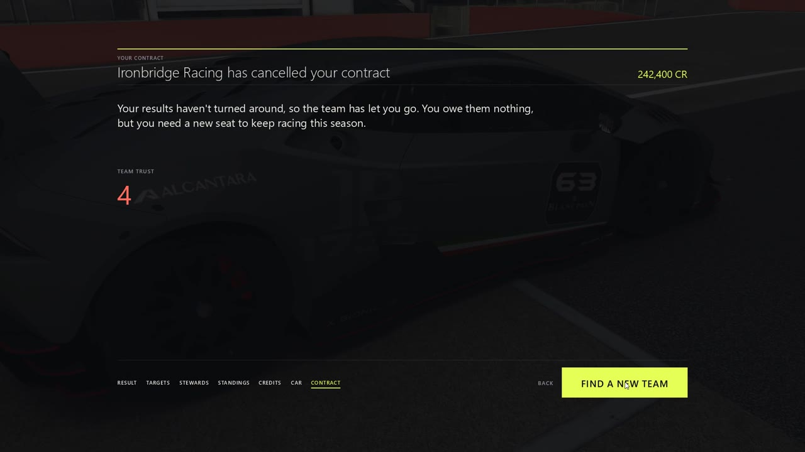
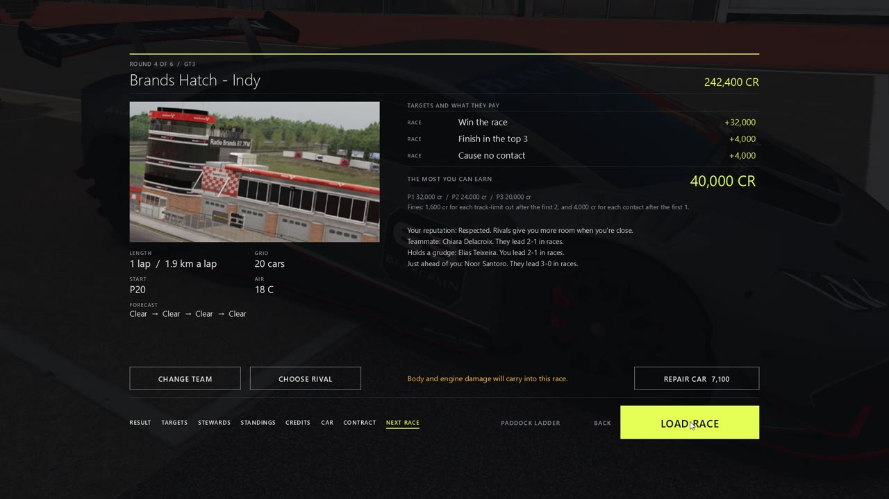

# Paddock Ladder

**A career where your team judges how you drive.**

Paddock Ladder is a free career mode for the original Assetto Corsa. It builds series from whatever cars and tracks you have installed, including mods. Teams hire you, warn you and sack you based on how you race, and stewards rule on every contact so you only pay for what you caused.

## Why play it

Plenty of mods give Assetto Corsa a progression system. Paddock Ladder is built around your conduct.

- **Stewards rule on every contact.** The game looks at where both cars were and how they were moving just before the hit, then decides whether it was your fault, their fault or a racing incident. Only your fault costs you.
- **Your reputation changes how the grid races you.** Drive clean and rivals give you more room. Drive dirty and they fight you harder.
- **Contracts have teeth.** Team trust rises and falls with each race. Lose it and you go on notice, then get sacked mid-season.
- **A real driver market.** Approach rival teams during a season, buy out your contract, or choose a rival to beat. Your teammate and rivals are compared with you across the season.
- **Everything happens in the game.** Results, repairs, contract offers and the next race briefing are all on in-game screens.

## Install

You need Windows 10 or 11, the original Assetto Corsa and [Custom Shaders Patch](https://acstuff.club/patch/). [Content Manager](https://assettocorsa.club/content-manager.html) is recommended. Development and testing used CSP 0.3.0-preview342, and other versions are untested.

1. Download `PaddockLadder-2.20.0.zip` from [Releases](../../releases).
2. Drag it onto the Content Manager window and click **Install**. Without Content Manager, unzip it into your game folder.
3. Run `PaddockLadder.exe` from `apps\lua\PaddockLadder` in your game folder. A desktop shortcut is handy.

**About the Windows warning:** the program isn't code-signed yet, so Windows may say it's from an unknown publisher. Click **More info**, then **Run anyway**. You can read every line of the source here, and each release lists a VirusTotal scan and checksum for its exe. Releases are built from this source by GitHub Actions.

## How a career works

1. Create a career and choose whether damage is on. Climb the ladder from slow road cars, or pick any series.
2. View a car, check the deal and sign a contract. You start with 30,000 credits.
3. Read the briefing: track, weather, every target and what it pays.
4. Race a weekend of practice, qualifying and the race on a 20-car grid.
5. After the flag, step through your result, targets, stewards' rulings, standings, credits and the state of your car.
6. Repair what you can afford, then load the next race. Keep the launcher running in the background, because that's where races are scored.

## How you're judged

- **Stewards:** a car that runs into the back of another takes the blame, and so does one that moves across another side by side. Equal contact, or being hit after you've spun or stopped, is a racing incident. Rejoining the track into someone is on you.
- **Contract targets:** only contact you caused counts against them. Meeting targets builds team trust.
- **Clean driving:** cuts and contact you caused lower your rating, which sets your reputation and helps decide promotions.
- **Licence:** dirty races add penalty points. On probation, teams won't promote you.
- **Rivals:** a driver you hit holds a grudge and races harder when close. You can also pick your own rival, who fights you harder and pays a bonus when you beat them.

Quitting once the race has started is a retirement: no points, a cost, and your damage still counts. A real game crash leaves the round open.

## Moving up

Teams score each season on championship position (55%), clean driving (30%) and team trust (15%). A score of 62% earns promotion and under 30% drops you a tier.

## Credits, cars and damage

You buy each tier's car, with half its price back as a trade-in. Seats have a fee after your rookie season. If you can't afford a seat, the team lends you a car and keeps half your winnings. Fines can put you in debt, and future earnings pay that off first.

Repair parts one at a time, or only halfway. Damage stays on the car through practice, qualifying and the race until you fix it. Gearbox and suspension damage can't be loaded directly, so they carry over as slower shifts, a steering pull and less grip. Damage can be turned off for a career.

## Good to know

- Careers are saved in `Documents/Assetto Corsa/paddock_ladder/careers`.
- With the Pure weather mod installed, each race has four weather stages. Paddock Ladder never includes Pure's files.
- The launcher closes the results windows Content Manager leaves behind after each race.
- The menu music, sounds and logo are original.

## Building from source

Run `launcher\build.ps1` on Windows. It uses the C# compiler that ships with Windows, so there's nothing to install. `launcher\build.ps1 -Test` builds the test version, and `launcher\tests` holds the automated checks and real-game test scripts.

## Licence

[MIT](LICENSE). Assetto Corsa is a product of Kunos Simulazioni, and this project isn't affiliated with or endorsed by them.
